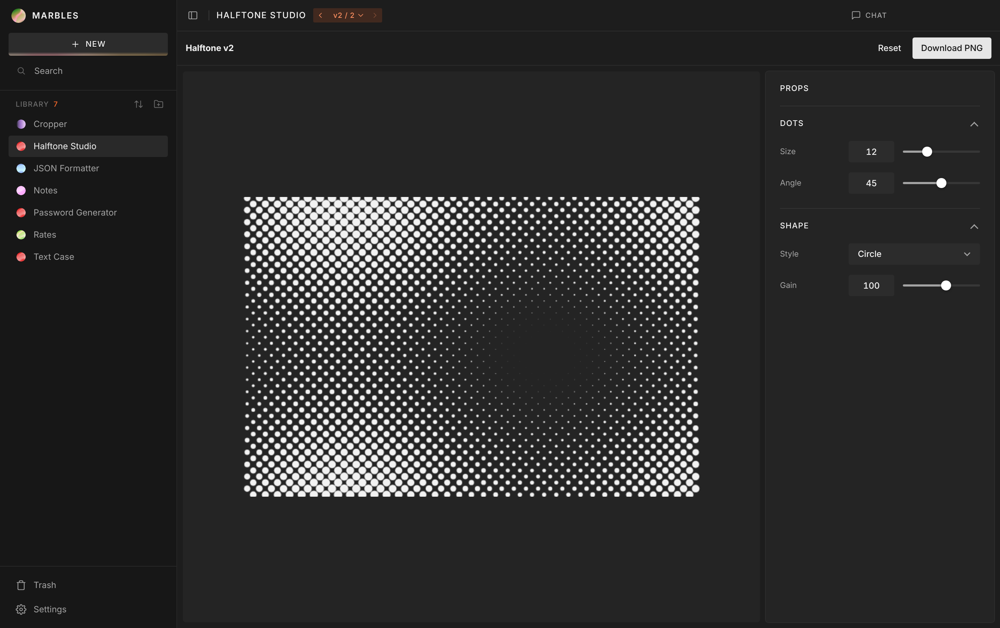

# Marbles

Marbles is a desktop app that builds small tools for you with AI and keeps them in a library. You describe what you need ("an image cropper with aspect presets", "a bill splitter"), and a minute later it is a working app in your sidebar. To change it, say what to add or fix. Every change is a new version you can undo.



- **Your tools stay with you.** Each one is a plain HTML file in a folder on your computer. There is no account and no Marbles server.
- **Bring your own AI.** Sign in with a ChatGPT Plus or Pro plan, or add an [OpenRouter](https://openrouter.ai) API key and pick any model.
- **Tools run in a sandbox.** A generated tool can't read your files or reach the rest of your computer.
- **Export** any tool as a single HTML file that opens in a browser.

Marbles is free software under the [GPL v3 or later](LICENSE). It runs on Windows, macOS and Linux.

## Download

Get the latest version from the [releases page](https://github.com/edbergc7/marbles/releases/latest):

| System  | File                            |
| ------- | ------------------------------- |
| Windows | `marbles-<version>-win-x64.zip` |
| macOS   | `marbles-<version>.dmg`         |
| Linux   | `marbles-<version>.AppImage`    |

**The builds are not code-signed.** Signing certificates cost money every year and Marbles is free, so your system will warn you the first time you open it. The steps below get you past the warning. If you would rather not trust a download, you can [build it from source](CONTRIBUTING.md).

Marbles never installs anything by itself. When a new version is out it shows a banner with a link back to the releases page.

## Install

### Windows

1. Extract the zip to a folder you'll keep, such as `Documents\Marbles`.
2. Run `marbles.exe`.
3. Windows shows "Windows protected your PC". Click **More info**, then **Run anyway**.

### macOS

1. Open the `.dmg` and drag Marbles into Applications.
2. Open Marbles. macOS says it can't verify the app and refuses. Click **Done**.
3. Open **System Settings → Privacy & Security**, scroll down to the message about Marbles and click **Open Anyway**. Confirm with your password or Touch ID.

You only do this once. If macOS says the app "is damaged" instead, clear the download flag and open it again:

```bash
xattr -dr com.apple.quarantine /Applications/Marbles.app
```

### Linux

```bash
chmod +x marbles-*.AppImage
./marbles-*.AppImage
```

Two things can stop it from starting on Ubuntu and systems based on it.

**"AppImages require FUSE to run."** Install libfuse2:

```bash
sudo apt install libfuse2t64   # Ubuntu 24.04 and later
sudo apt install libfuse2      # Ubuntu 22.04
```

**"The SUID sandbox helper binary was found, but is not configured correctly."** Ubuntu 24.04 and later block the feature Chromium's sandbox is built on unless an app has an AppArmor profile. Give Marbles one. Keep the AppImage in a fixed place such as `~/Applications`, then create `/etc/apparmor.d/marbles` with your own path in it:

```
abi <abi/4.0>,
include <tunables/global>

profile marbles /home/YOU/Applications/marbles-*.AppImage flags=(unconfined) {
  userns,
  include if exists <local/marbles>
}
```

Load it:

```bash
sudo apparmor_parser -r /etc/apparmor.d/marbles
```

Starting Marbles with `--no-sandbox` also gets past the error, but it turns off a layer of protection around the tools Marbles generates. Use the profile.

Without a password keyring (GNOME Keyring or KWallet), Marbles can't store your sign-in or API key encrypted. It asks whether to keep it for the session only or save it unencrypted.

## What leaves your computer

Marbles has no server, no account, no analytics and no crash reporting. It connects to these places and no others:

**Your AI provider, when you build or change a tool.** Marbles sends your request, and when you change a tool, that tool's current code and your recent messages about it. When you click Fix on an error, the error text goes too. A small extra request names each new tool. This goes to one of:

- **OpenRouter** (`openrouter.ai`), with your API key. Marbles also loads OpenRouter's public list of models.
- **OpenAI** (`auth.openai.com` to sign in, `api.openai.com` to build), if you sign in with ChatGPT.

Marbles doesn't send your other tools, the data you put into them, or anything else on your computer. What the provider does with your requests is covered by its own privacy policy.

**GitHub, twice a day and at startup.** Two plain requests with nothing about you or your tools in them: one for the latest release, one for announcements such as a bug warning. Turn them off in **Settings → Updates**.

**Whatever a tool you made needs.** Tools are sandboxed and can't open network connections themselves. Through Marbles they can:

- load code libraries from `cdnjs.cloudflare.com`, `cdn.jsdelivr.net` and `unpkg.com`, which Marbles keeps a copy of after the first download
- show images from `https` addresses
- fetch data from the public internet if the tool was built to, such as a currency converter fetching rates
- ask your AI provider something if the tool was built to, such as an email rewriter

Tools can't reach your computer or your home or office network unless you allow it in **Settings → Network**.

## Where your things are kept

| System  | Folder                                  |
| ------- | --------------------------------------- |
| Windows | `%APPDATA%\Marbles`                     |
| macOS   | `~/Library/Application Support/Marbles` |
| Linux   | `~/.config/Marbles`                     |

The library (your tools, their versions and chats) is in `library` inside that folder. You can move it in **Settings → Library**, for example into a synced folder. Your API key and ChatGPT sign-in are stored there too, encrypted with your system's keychain.

Uninstalling Marbles is deleting the app, and that folder if you don't want to keep your tools.

## Contributing

[CONTRIBUTING.md](CONTRIBUTING.md) covers running Marbles from source, the checks and how releases are made. Bug reports and ideas are welcome in the issue tracker.

## License

Marbles is licensed under the [GNU General Public License v3.0 or later](LICENSE).

It includes the Inter typeface, under the [SIL Open Font License](resources/fonts/OFL.txt). The ChatGPT logos in `src/renderer/src/assets/siwc` belong to OpenAI and are not covered by the GPL. Marbles is not affiliated with OpenAI, OpenRouter or GitHub.
